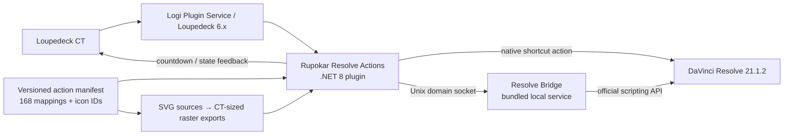

# Rupokar Resolve CT — Architecture & Icon Plan

## Goal

Create a macOS package for Loupedeck CT and DaVinci Resolve 21.1.2 that implements the 168 catalogued control assignments/options from the walkthrough reference. The delivery consists of an installable Loupedeck plugin, an importable CT profile, a local Resolve automation bridge, a reusable icon pack, and setup/validation documentation.

The count of 168 is an implementation inventory: repeated physical mappings, dial turns versus presses, timer durations, colors, and export presets are intentionally counted separately. It is not a claim that Resolve has 168 unrelated commands.

## Product boundary

| Layer | Owns | Does not own |
|---|---|---|
| Loupedeck CT profile | Page layouts, physical-control placements, shortcut actions, icon placement | Resolve project state or render logic |
| Rupokar Resolve Actions plugin | CT action definitions, dynamic labels, Break Timer state, action feedback, calls to the bridge | Editing a Resolve project directly |
| Resolve Bridge | Resolve Scripting API commands, export presets/queue status, timeline copies | CT layouts or icon placement |
| DaVinci Resolve | Project/timeline, native edit commands, rendering | Long-running local timer state |



## Why this architecture

The official Loupedeck profile model already supports a profile as a container for actions, custom icons, and custom actions. A profile can be imported/exported and linked to an application. [Loupedeck profile overview](https://support.loupedeck.com/profiles.html) and [profile import/export](https://support.loupedeck.com/how-to-import-and-export-profiles.html) support that distribution model.

Loupedeck 6 runs plugins through the Logi Plugin Service and supports the .NET 8 Plugin SDK, so the plugin layer should be a C#/.NET 8 package. [Loupedeck 6 release notes](https://support.loupedeck.com/release-notes-7.html) and the [Logi Actions SDK introduction](https://logitech.github.io/actions-sdk-docs/csharp/plugin-development/introduction/) confirm that platform. The Resolve Bridge remains local because the current Resolve API can inspect render presets, queue jobs, start/stop rendering, track job status, and access Quick Export capabilities.

## Action routing

| Route | Use for | Examples from catalog | Implementation |
|---|---|---|---|
| Profile shortcut | Stable Resolve keyboard actions | Split, trim, ripple, marker, save, undo, panels | CT control sends the matching Resolve keyboard shortcut; profile ships with a named Resolve keyboard-preset requirement |
| Plugin state action | CT-owned, stateful behavior | Break Timer, timer status, dynamic button label, workspace navigation | C# action maintains state and redraws the CT label/icon |
| Bridge command | Commands needing Resolve data/API | Render preset selection, Add to Queue, Render New, Stop Render, Clear Queue, custom 9:16/4:5/4:3 timeline copies | Plugin sends a typed local request; bridge invokes Resolve scripting API and returns a result/state |
| Hybrid | UI action with a script fallback | Quick Export, thumbnail, open export folder, proxy/original mode | Use API where it is available/reliable; use a documented shortcut fallback where the API cannot reproduce the UI action exactly |

## Plugin/bridge request contract

Every advanced action uses one typed command, never an arbitrary shell string.

```text
Plugin action
  → { id, requestId, activeProject, activeTimeline, payload }
  → Unix-domain socket at user-scoped application-support location
  → Bridge validates id/payload and calls Resolve API
  ← { requestId, ok, state, message, value? }
  → Plugin updates CT feedback, or shows a concise failure state
```

Required action IDs include `render.preset.youtube`, `render.queue.add`, `render.start.all`, `render.start.new`, `render.stop`, `render.queue.clear`, `timeline.copy.9x16`, `timeline.copy.4x5`, `timeline.copy.4x3`, `timer.start`, and `timer.stop`.

The bridge must only accept a fixed allow-list of action IDs over a user-owned Unix socket. No LAN listener, arbitrary script execution, or externally reachable render endpoint is needed.

## Icon system

### Source of truth

`final-icon-manifest.json` is generated directly from the 168-row catalog. Each record has a stable ID, action name, CT control, source timestamp, source section, asset type, and its final recreated SVG path. `reference-icon-manifest.json` retains the supplied-walkthrough crop coordinates as audit evidence, so a mapping can be verified without making a screenshot crop the shipped icon.

### Visual rules

- One individual icon source per catalog row.
- Each source is an exact CT button, dial, wheel, or physical-key crop taken from the supplied walkthrough; the catalog's own labels and artwork are therefore preserved.
- Every recreated SVG has a CT-specific layout: a square touch tile, a narrow dial label, or a physical/Fn legend. Its matching PNG crop, source frame, and crop coordinates remain recorded for review.
- The reference-crop assets replace generic concept glyphs. Any later custom redraw must first be reviewed against its corresponding source crop.

### Glyph families

| Family | Examples |
|---|---|
| Media & project | import tray, bin/folder, note, project grid, camera, proxy, settings |
| Edit | trim brackets, scissors, ripple arrows, marker pin, magnet, speed, link, loop |
| Navigation | shuttle arrows, zoom, frame wheel, timeline ends, clip up/down |
| Color | node graph, scopes, RGB printer lights, split comparison, still frame |
| Fairlight | waveform, fades, track height, audio loop |
| Deliver | destination document, queue stack, render/play, stop, export folder, thumbnail |
| Timer | clock ring, duration number, play, stop, break alert |

The generated PNG crops are audit-only review assets. The recreated SVGs are the package source assets. A later packaging step reads the exact Loupedeck 6.4.1 icon size/formats from the installed SDK/profile tooling and exports only the required raster format. This avoids guessing a device image dimension.

## Package layout

```text
rupokar-resolve-ct/
├── catalog/
│   ├── actions.json                 # 168 mappings; generated from master catalog
│   ├── final-icon-manifest.json     # one stable final SVG record per action
│   ├── reference-icon-manifest.json # crop evidence only
│   └── resolve-keyboard-preset.md
├── icons/
│   ├── final-svg/                   # 168 recreated deterministic SVG sources
│   ├── Final-Icon-Board.html        # final SVG + optional reference review board
│   └── export/                      # CT-sized files generated during packaging
├── plugin/
│   └── Rupokar.Resolve.Actions/     # C# / .NET 8 Logi Actions SDK plugin
│       ├── Actions/                 # one class per action family
│       ├── Feedback/                # tile label, timer state, queue status
│       ├── Bridge/                  # typed socket client
│       └── Assets/                  # packaged icons and profile resources
├── bridge/
│   └── rupokar_resolve_bridge/      # bundled local Resolve scripting service
│       ├── command_router.py
│       ├── resolve_client.py
│       ├── render_service.py
│       ├── timeline_service.py
│       └── socket_server.py
├── profile/
│   └── Rupokar-Resolve-CT.*         # export produced by Loupedeck 6.x
└── docs/
    ├── install.md
    ├── permissions.md
    ├── action-matrix.md
    └── validation-checklist.md
```

## Resolve Bridge responsibilities

1. Connect only when Resolve is running and return a readable “Resolve unavailable” response otherwise.
2. Check the required Studio capability before Studio-only actions and leave non-Studio routes usable.
3. Read installed render presets before enabling Custom 1–3; map only names ending in `#1`, `#2`, or `#3`.
4. Use the Resolve API for queue management, rendering, job status, Quick Export status, and render-preset selection. Do not automate button clicks in Resolve.
5. Create aspect-ratio copies as new timelines and preserve the source timeline unchanged.
6. Return enough status for CT feedback: queued, rendering, complete, stopped, missing preset, API unavailable, or action failed.

## Break Timer design

- Plugin-owned countdown, so it remains responsive even when Resolve is busy.
- Fixed catalog durations: 25m, 45m, 1h, 1.5h, 2h, 2.5h, 3h, 4h.
- State machine: `idle → duration_selected → running → elapsed → stopped`.
- Running state displays remaining time. Elapsed state displays Break! and sends one macOS notification. It never stops playback or modifies the Resolve project.
- Start, Stop, and Rushwise remain separate actions, exactly as catalogued.

## Development sequence

1. Freeze the `actions.json` manifest from the audited master catalog; each action gets one ID, one CT placement, one edition tag, one route, and one icon ID.
2. Review the generated 168 SVGs on the Icon Board. Correct semantics/labels before raster export.
3. Create the .NET 8 plugin skeleton from the Logi Actions SDK; implement navigation and timer feedback first.
4. Build the local Resolve Bridge with an allow-listed command router; implement status/health endpoint and the render-queue family next.
5. Add the Resolve keyboard preset for shortcut-routed Edit, Color, Fairlight, physical-key, and panel actions.
6. Assemble the CT profile in Loupedeck 6.4.1, attach every action and icon, export it, then preserve the exported file as the distributable profile artifact.
7. Validate all actions against a disposable Resolve project: first shortcut controls, then timer, then each render/queue action, then aspect-ratio copies.
8. Package installer, profile, icons, keyboard preset, and setup guide. The install guide includes the walkthrough's requirement to select the pack keyboard shortcuts and set Resolve External Scripting to Local.

## Acceptance criteria

- 168 manifest rows have exactly one icon source and a catalog timestamp.
- Every CT button/dial assignment matches the Master Reference control location.
- All standard actions work using the supplied Resolve keyboard preset.
- Studio-only buttons clearly show unavailable state in Free Resolve instead of silently failing.
- Export controls never alter a render preset outside the selected action, and queue mutations return a visible success/failure state.
- Aspect-ratio functions create copies rather than modifying the source timeline.
- Break Timer survives Resolve page changes and does not interrupt editing when it elapses.
- The profile imports in Loupedeck 6.x and is bound to DaVinci Resolve on macOS.

## Current verification basis

- Current Mac: DaVinci Resolve 21.1.2 is running.
- Official Loupedeck support currently lists Loupedeck 6.4.1 for macOS. [Download page](https://support.loupedeck.com/loupedeck-software-download.html)
- Loupedeck 6 uses the .NET 8 Plugin SDK. [Release notes](https://support.loupedeck.com/release-notes-7.html)
- Current Resolve scripting API exposes `LoadRenderPreset`, `AddRenderJob`, `StartRendering`, `StopRendering`, `DeleteAllRenderJobs`, render job status, and Quick Export APIs. The final implementation must check the installed API at build time and retain shortcut/UI-safe fallbacks only where an API command is absent.
