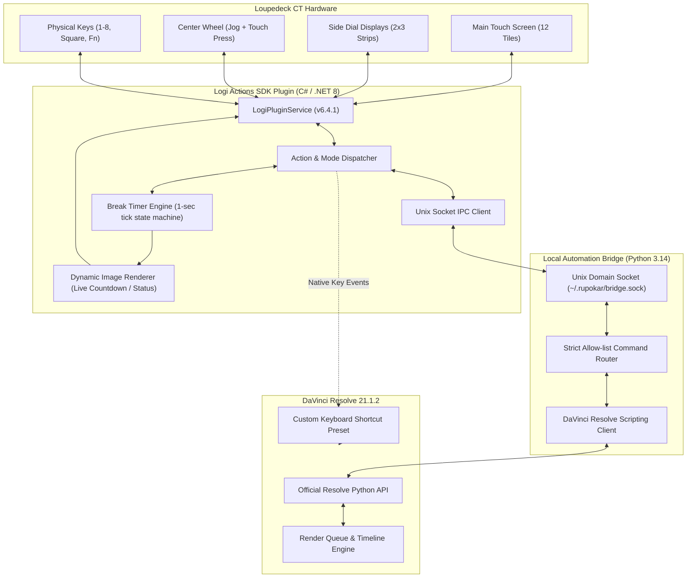

# Rupokar Resolve CT Pack — System Architecture & Icon Design Specification

- **Date:** 2026-11-04
- **Project:** Rupokar Studios LoupeDeck Pack
- **Target Hardware:** Loupedeck CT (`Loupedeck50`)
- **Target Host Application:** DaVinci Resolve 21.1.2 (Studio & Free) on macOS
- **Loupedeck Software:** Logi Plugin Service / Loupedeck 6.4.1.364

---

## 1. Executive Summary & Goals

The Rupokar Resolve CT Pack is a professional, complete hardware workflow suite mapping **168 catalogued control assignments and options** from the Loupedeck CT DaVinci Resolve walkthrough into a cohesive macOS distribution.

The solution consists of:
1. **Multi-Ratio Vector Icon System:** 168 custom vector icons with control-specific aspect ratios (Touch 256×256, Dial vertical strip 120×180, Physical preview 320×160), with all fallback spark icons replaced by purpose-built glyphs.
2. **Logi Actions .NET 8 C# Plugin (`Rupokar.Resolve.Actions`):** Native plugin providing real-time dynamic countdown timers, render queue feedback, and local socket routing.
3. **Local DaVinci Resolve Automation Bridge (`rupokar_resolve_bridge`):** Python-based daemon communicating over a secure Unix domain socket to execute official DaVinci Resolve Scripting API commands (render jobs, preset loading, timeline aspect-ratio duplication).
4. **Loupedeck CT Profile (`Rupokar-Resolve-CT.lp5`):** Native 8-workspace profile mapping the entire hardware interface (Touch, Dials, Center Wheel, and Physical/Fn buttons).
5. **DaVinci Resolve Keyboard Preset (`Rupokar_Resolve_Keys.txt`):** Conflict-free keyboard shortcut mapping for 100% reliable hardware triggers.

---

## 2. Architecture & Component Interaction



---

## 3. Multi-Ratio Icon SVG Architecture

### 3.1 Device-Specific Dimensions & Ratios
To match the physical geometry of Loupedeck CT:
- **Touch Tiles (94 Actions):**
  - **Resolution:** 256×256 px (1:1 square).
  - **Visual Language:** Dark base `#15181E`, 2.5px category accent line, high-contrast stroke-width 10 minimal vector glyph, bold 18px text label.
- **Dial Strips (44 Actions):**
  - **Resolution:** 120×180 px (2:3 portrait strip).
  - **Visual Language:** Tailored for Loupedeck CT side screen strips. Upper 60% contains the vector glyph, middle displays the parameter name, and bottom features a color-coded `TURN` or `PRESS` indicator.
- **Physical Keys & Fn Layer (30 Actions):**
  - **Resolution:** 320×160 px (2:1 wide card).
  - **Visual Language:** Designed for Loupedeck configuration UI previews, reference manuals, and visual audit boards.

### 3.2 Redesigned Custom Glyphs (Fixing the 8 Fallbacks)
The 8 generic `spark` fallbacks identified during project audit are replaced with precise custom vector artwork:
1. **`Timeline 9:16` (`rupokar.final.018`):** 9:16 vertical smartphone frame with play/timeline marker.
2. **`Timeline 4:5` (`rupokar.final.019`):** 4:5 social portrait aspect ratio frame with dimension arrows.
3. **`Timeline 4:3` (`rupokar.final.020`):** 4:3 classic television viewport with corner rule marks.
4. **`Rushwise` (`rupokar.final.031`):** Project manager compass/diamond emblem.
5. **`Audio Level` (`rupokar.final.049`):** Professional studio dB channel fader with level gradient ticks.
6. **`Dynamic Trim` (`rupokar.final.051`):** Dual opposing yellow trim brackets with directional cut indicators.
7. **`Dynamic Trim On/Off` (`rupokar.final.052`):** Power toggle ring enclosing dynamic trim bracket icon.
8. **`Effects Library` (`rupokar.final.106`):** Magic wand emitting FX stars over a layered tool palette.

### 3.3 Accent Color Palette by Workspace
- **Navigation / Physical:** `#A88CFF`
- **Media / Project:** `#B79AFF`
- **Media / Break Timer:** `#4EE0E2`
- **Edit 1, 2, 3:** `#64AAFF`, `#72B6FF`, `#8CB5FF`
- **Color:** `#46D9C4`
- **Fairlight:** `#80E06A`
- **Deliver & Quick Export:** `#C9A0FF`
- **Clip Colors (15 Dials):** Exact Resolve color swatches (`Orange`, `Yellow`, `Green`, `Apricot`, `Blue`, `Lime`, `Brown`, `Pink`, `Purple`, `Olive`, `Teal`, `Navy`, `Violet`, `Tan`, `Beige`).

---

## 4. Plugin Layer & Live Dynamic Feedback

### 4.1 C# / .NET 8 Plugin Specification
The plugin `Rupokar.Resolve.Actions` targets .NET 8 using Logitech's Logi Actions SDK:
- **`BreakTimerAction` State Machine:**
  - States: `Idle` → `IntervalSelected` → `Running` → `Elapsed` → `Stopped`.
  - Durations: 25m, 45m, 1h, 1.5h, 2h, 2.5h, 3h, 4h.
  - Dynamically renders remaining minutes and seconds (`MM:SS`) onto the CT tile image at 1 Hz.
  - On elapsed: flashes high-contrast `BREAK!` alert and triggers a native macOS user notification via `osascript`.
- **`RenderQueueAction` Live Feedback:**
  - Polling every 2 seconds during active rendering to display progress (`Render: 42%`, `Queued: 3`, `Render Done`).
- **`QuickExportAction` & `TimelineAspectAction`:**
  - Adapts between Studio and Free editions.

### 4.2 Local Bridge IPC Contract
Communication between the C# plugin and the Python bridge uses a local Unix domain socket (`~/.rupokar/bridge.sock`):
- **Request Format (JSON):**
  ```json
  {
    "id": "render.start.all",
    "requestId": "uuid-v4",
    "payload": {}
  }
  ```
- **Response Format (JSON):**
  ```json
  {
    "requestId": "uuid-v4",
    "ok": true,
    "state": "RENDERING",
    "message": "Render jobs started"
  }
  ```

---

## 5. Loupedeck CT Profile Layout (8 Workspaces)

- **Round 1 (Media):** Project Settings, New Bin, Import Media, Power Bins, Notes, Project Manager, New Project, Prefer Proxy, Camera Originals, Timeline 9:16, Timeline 4:5, Timeline 4:3. Swipe right loads Break Timer.
- **Round 2 (Edit 1):** Timeline Zoom, Shuttle dial, Fast Shuttle dial, Dynamic Trim dial, Audio Level dB dial, Next Clip dial, Snapping, Ripple Start/End, Split, Trim Start/End, Retime, Orange/Yellow/Green color dials.
- **Round 3 (Edit 2):** Markers, Link/Unlink, Compound Clip, Normalize, Auto Align, Mark In/Out, Loop, Match Frame, Cinema Viewer, and 12 additional clip colors accessed by dialing down.
- **Round 4 (Edit 3):** Delete Gaps, Swap Left/Right, Enable Clip, Freeze Frame, Title Safe, Find Clip, Find Timeline, Duplicate Timeline.
- **Round 5 (Color):** Add Node, Node Before, Label Node, Grab Still, Scopes, Light Box, Split Comparisons, Saturation/Gamma/Gain dials, Printer Lights RGB dials.
- **Round 6 (Fairlight):** Batch Fades Settings, Apply Batch Fades, Track Height dial, Waveform Zoom dial, Loop.
- **Round 7 (Deliver):** YouTube, Vimeo, TikTok, Instagram 4:5, ProRes 422 HQ, Custom Presets 1-3, Add to Queue, Render All, Render New, Stop Render, Clear Queue, Thumbnail, Export Folder.
- **Round 8 (Quick Export):** One-tap Quick Export and Free Deliver controls.
- **Center Wheel:** Jog wheel (frame-by-frame) + center press Play/Pause.
- **Physical Keys & Fn Layer:** Undo, Save, Up Track, Down Track, Timeline Start/End, Right Click, Ripple Delete, and Fn + 1–8 for instant Resolve panel switching.

---

## 6. Project Directory Structure

```text
Rupokar Studios LoupeDeck Pack/
├── icons/
│   ├── final-svg/
│   │   ├── touch/                   # 94 touch tiles (256x256)
│   │   ├── dial/                    # 44 dial strips (120x180)
│   │   └── physical/                # 30 physical legends (320x160)
│   ├── export-png/                  # High-DPI raster exports
│   ├── Final-Icon-Board.html        # Interactive HTML visual verification board
│   └── final-icon-manifest.json     # Manifest containing metadata for all 168 assets
├── plugin/
│   └── Rupokar.Resolve.Actions/     # C# / .NET 8 Logi Actions SDK project
│       ├── Actions/
│       ├── DynamicDisplay/
│       ├── IPC/
│       └── Rupokar.Resolve.Actions.csproj
├── bridge/
│   └── rupokar_resolve_bridge/      # Python 3 DaVinci Resolve automation service
│       ├── bridge_service.py
│       ├── resolve_api.py
│       └── socket_server.py
├── profile/
│   └── Rupokar-Resolve-CT.lp5       # Ready-to-import Loupedeck 6.4.1 CT profile
├── keyboard-preset/
│   └── Rupokar_Resolve_Keys.txt     # DaVinci Resolve Keyboard Shortcut mapping
├── scripts/
│   ├── build_icons.py               # Vector generation and PNG export tool
│   ├── build_profile.py             # Profile assembler
│   └── run_bridge.sh                # Bridge daemon launch script
└── docs/
    ├── install-guide.md
    └── validation-checklist.md
```

---

## 7. Verification & Acceptance Criteria

1. **Icon Integrity:** All 168 icons exist as valid, crisp SVGs and matching PNGs; no generic `spark` fallbacks remain.
2. **Hardware Geometry:** Touch tiles render square; dials render vertical strips with distinct `TURN` / `PRESS` badges.
3. **Dynamic Feedback:** Break Timer displays live countdown seconds on the CT hardware and triggers a macOS notification on completion.
4. **Bridge Connectivity:** The local socket service connects to DaVinci Resolve 21.1.2 Scripting API without errors, and gracefully handles Resolve offline state.
5. **Profile Usability:** The `.lp5` profile imports directly into Loupedeck 6.4.1, automatically binding to DaVinci Resolve.
